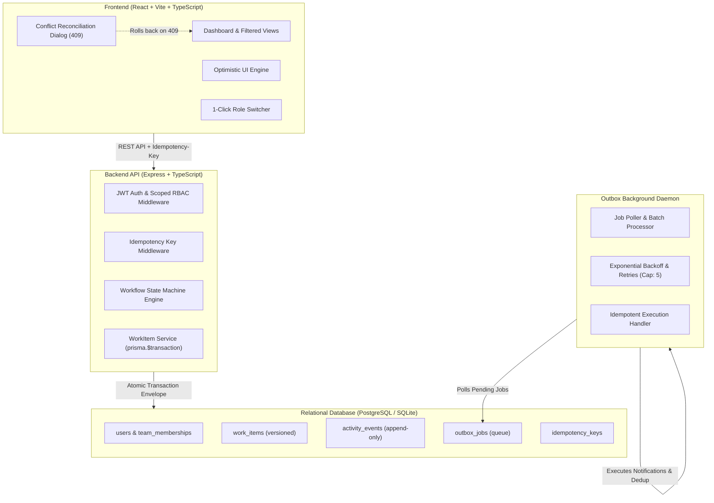

# Newtonite Ops — Operations Under Pressure

[](#how-to-run-tests)
[](https://nodejs.org)
[](https://www.postgresql.org)
[](#system-architecture)

> **Newtonite Software Engineering Challenge Submission**  
> An internal operations web application engineered for cross-team incident triage, concurrency safety, server-enforced workflow state machines, and reliable asynchronous job execution.

---

## What the App Does

**Newtonite Ops** is a mission-critical operations web application designed to create, assign, triage, and resolve operational work items across teams under high concurrency. It provides guaranteed atomic history tracking, race-condition-safe work claiming, version-controlled optimistic locking, role-scoped workflow state machines (e.g. Lead-only approvals), and a transactional outbox queue with exponential backoff retries.

---

## System Architecture



---

## Critical Behaviours Implemented

Newtonite required implementation of critical behaviours beyond simple CRUD. All 7 behaviours are fully implemented and verified with automated tests:

| Critical Behaviour | Implementation Mechanism | Automated Test Coverage |
| :--- | :--- | :--- |
| **1. Concurrent Item Claim** | Conditional atomic update: `UPDATE work_items SET assigneeId = ?, status = 'IN_PROGRESS', version = version + 1 WHERE id = ? AND assigneeId IS NULL;` | `tests/critical_behaviours.test.ts` (Fires 2 parallel claims; exactly 1 succeeds with 200, loser gets 409) |
| **2. Stale Update Handling** | Optimistic concurrency locking: Client submits `version`. Server updates only `WHERE version = expectedVersion`. Returns 409 Conflict with latest state on mismatch. | `tests/critical_behaviours.test.ts` (Stale edit rejected, data unchanged, latest resource returned) |
| **3. Idempotency Keys** | Client passes `Idempotency-Key` header. Server captures sha256 request hash, caches HTTP response atomically, and replays cached response on duplicate calls. | `tests/critical_behaviours.test.ts` (Same key sent twice produces 1 database record & matching 201 response) |
| **4. Strict Workflow State Machine** | Server-enforced transition map: `OPEN → IN_PROGRESS → AWAITING_APPROVAL → RESOLVED → CLOSED`. Approving from `AWAITING_APPROVAL` strictly restricted to `LEAD` or `ADMIN`. | `tests/critical_behaviours.test.ts` (Direct jump `OPEN → CLOSED` rejected with 400; Member approval rejected with 403; Lead approval accepted) |
| **5. Resource-Level Authorization** | Server validates user's membership and role (`VIEWER`, `MEMBER`, `LEAD`, `ADMIN`) scoped to target item's team on every read/write. | `tests/critical_behaviours.test.ts` (Cross-team query returns 403; Viewer role mutations return 403) |
| **6. Transactional Outbox Pattern** | Notification job record written inside the **exact same database transaction** as the work item update. Background worker polls, retries with exponential backoff (`2^attempts * 1s`), caps at 5 attempts, and deduplicates. | `tests/critical_behaviours.test.ts` (Job executed idempotently; failing job retries with backoff and marks dead-letter FAILED) |
| **7. Optimistic UI Reconciliation** | Frontend optimistically updates card state on claim/edit. On 409 Conflict, UI rolls back and opens a rich Concurrency Conflict Modal with diff and reload action. | Verified in interactive browser subagent |

---

## Prerequisites & Run Commands

You can run the project either via **Docker Compose** (PostgreSQL) or **Local Node.js** (SQLite zero-install).

### Option A: Running with Docker Compose (Recommended for Reviewers)

```bash
# 1. Clone the repository
git clone https://github.com/newtonite-ops/newtonite-ops-project.git
cd newtonite-ops-project

# 2. Build and start containers (PostgreSQL, Backend API, Worker, and Frontend)
docker compose up --build
```
- Frontend UI: `http://localhost:5173` (or `http://localhost:80`)
- Backend API & Health Check: `http://localhost:4000/api/health`

---

### Option B: Running Locally (Zero-Install Local SQLite)

Requires Node.js v18+ and npm v9+.

```bash
# 1. Install all dependencies across workspaces
npm install

# 2. Push schema and seed demo data (4 teams, 10 users, 1,200 work items)
npm run db:push
npm run db:seed

# 3. Start full stack (Backend + Worker + Frontend concurrently)
npm run dev
```

- Frontend: `http://localhost:5173`
- Backend API: `http://localhost:4000`

---

## How to Run Tests

Run all unit, concurrency, idempotency, and workflow tests with one single command:

```bash
npm run test
```

### Test Suite Output:
```text
 ✓ tests/critical_behaviours.test.ts (9 tests)
   ✓ 1. Concurrency: Two users claim the same work item simultaneously -> exactly ONE wins, other gets 409
   ✓ 2. Stale Update Handling: Optimistic locking rejects outdated versions -> 409 Conflict with latest state
   ✓ 3. Idempotency: Duplicate requests with same Idempotency-Key return cached result -> exactly 1 item created
   ✓ 4. Workflow Rules: Rejects illegal jumps (OPEN -> CLOSED) with 400 Bad Request
   ✓ 4. Workflow Rules: Rejects AWAITING_APPROVAL -> RESOLVED for standard MEMBER, accepts for LEAD
   ✓ 5. Authorization: Returns 403 Forbidden when user from another team accesses an item
   ✓ 5. Authorization: Rejects mutations from VIEWER role with 403 Forbidden
   ✓ 6. Reliable Async Work: Transactional outbox processes jobs idempotently
   ✓ 6. Reliable Async Work: Retries failing job with exponential backoff and caps at maxAttempts

 Test Files  1 passed (1)
      Tests  9 passed (9)
```

---

## Demo Login Credentials per Role

The application includes a **1-click Persona Switcher** dropdown in the top navigation bar, allowing reviewers to switch between roles instantly without typing passwords. Alternatively, use standard login:

| Role | Email | Password | Assigned Teams & Clearance |
| :--- | :--- | :--- | :--- |
| **Global Admin** | `admin@newtonite.internal` | `Password123!` | Admin across all 4 operational teams |
| **Platform Lead** | `lead.platform@newtonite.internal` | `Password123!` | Lead in Platform Core (Can approve resolutions & reassign) |
| **Platform Engineer** | `dev.platform@newtonite.internal` | `Password123!` | Member in Platform Core (Can create, claim, submit for review) |
| **Billing Lead** | `lead.billing@newtonite.internal` | `Password123!` | Lead in Billing & Payments |
| **Billing Engineer** | `dev.billing@newtonite.internal` | `Password123!` | Member in Billing & Payments |
| **Trust Lead** | `lead.trust@newtonite.internal` | `Password123!` | Lead in Trust & Safety |
| **Trust Analyst** | `analyst.trust@newtonite.internal` | `Password123!` | Member in Trust & Safety |
| **Customer Ops Specialist** | `agent.ops@newtonite.internal` | `Password123!` | Member in Customer Operations |
| **Compliance Auditor** | `viewer.auditor@newtonite.internal` | `Password123!` | Viewer in Platform Core & Billing (Read-Only access) |

---

## Known Limitations

1. **In-Memory Worker Deduplication**: The outbox worker uses an in-memory dedup set for local execution. In multi-instance clustered deployments, this should be backed by a Redis distributed key store (`SETNX`) or a dedicated `dispatched_notifications` relational table.
2. **Search Query Engine**: Search currently utilizes indexed relational SQL substring matching (`contains`). At 100k+ work items, this should transition to PostgreSQL full-text search (`tsvector` / `GIN` index) or OpenSearch.
3. **No WebSockets for Live Multi-Tab Sync**: Kept intentionally clean with polling and optimistic reconciliation to adhere to the brief's advice to deliberately skip WebSockets in favor of solid concurrency control.

---

## Next Week I Would...

1. **Add Real-Time Multi-Cursor Collaboration**: Integrate PostgreSQL `LISTEN/NOTIFY` or Redis Pub/Sub with Server-Sent Events (SSE) so users see when another engineer is currently viewing or editing an item.
2. **Dynamic Custom Workflows**: Provide an admin UI to define custom transition graphs, SLA timers, and team escalation policies.
3. **Audit Log Export & Verification**: Add cryptographic hash chains (Merkle tree) across `activity_events` to prove historical tamper-proofing for SOC2/PCI-DSS compliance.
4. **Partitioning at 10x Scale**: Partition the `activity_events` and `outbox_jobs` tables by month/team to maintain sub-10ms query times at scale.
